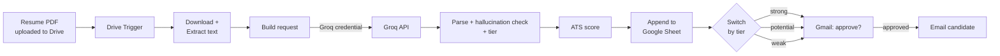

# 🧠 HireMind

**An AI-powered resume screening automation that gives recruiters evidence-backed shortlists, with a human making every final decision.**

> Screen faster. Verify every claim. Hire with confidence.

[Report a bug](../../issues) · [Request a feature](../../issues)


---

## Table of contents

- [Why HireMind?](#-why-hiremind)
- [Features](#-features)
- [How it works](#-how-it-works)
- [Human in the loop by design](#-human-in-the-loop-by-design)
- [Tech stack](#-tech-stack)
- [Architecture](#-architecture)
- [Getting started](#-getting-started)
- [Scoring explained](#-scoring-explained)
- [Troubleshooting](#-troubleshooting)
- [Responsible AI & limitations](#-responsible-ai--limitations)
- [Project status & roadmap](#-project-status--roadmap)
- [Contributing](#-contributing)
- [Author](#-author)
- [License](#-license)

---

## 🌍 Why HireMind?

Recruiters spend hours reading resumes, and AI screeners often give scores with no proof behind them. Recruiters end up asking:

- Does this candidate actually meet the must-have requirements?
- Where in the resume is the evidence?
- Can I trust the AI, or did it invent a skill?
- Which candidates deserve my time first?

HireMind turns a Google Drive folder into an automated screening pipeline. Every "met" requirement is backed by a quote from the resume, and anything the AI cannot prove is downgraded automatically.

---

## ✨ Features

| Feature | Description |
|---|---|
| 🤖 **AI screening** | Compares each resume to the job description using the Groq API (`openai/gpt-oss-120b`) and returns structured JSON. |
| 🔎 **Evidence-backed results** | Each requirement is marked `met`, `partial` or `not_met` with a verbatim quote from the resume. |
| 🛡️ **Hallucination guard** | Every quote is checked against the resume text. Unverified claims are downgraded to `not_met` and flagged. |
| 🏷️ **Code-based tiering** | Candidates are tiered `strong`, `potential` or `weak` in code, not by the model. |
| 📊 **ATS score** | A separate 0-100 score covers keywords, sections, contact info and readability. |
| 🗂️ **Auto logging** | Every result is appended to a Google Sheet. |
| ✅ **Email approvals** | The recruiter approves or rejects each candidate from their inbox. |
| ✉️ **Candidate updates** | On approval, the candidate is emailed automatically. |

---

## 🧭 How it works

| Step | Stage | What happens |
|:---:|---|---|
| 01 | 📥 **Upload** | A new PDF resume lands in a Google Drive folder (polled every minute). |
| 02 | 📄 **Extract** | The resume is downloaded and its text, name and email are extracted. |
| 03 | 🧠 **Screen** | Groq compares the resume to the must-have and nice-to-have requirements. |
| 04 | 🛡️ **Verify** | Each evidence quote is checked against the resume. |
| 05 | 🏷️ **Score** | The tier and ATS score are computed in code. |
| 06 | 🗂️ **Log** | The result is appended to Google Sheets. |
| 07 | ✅ **Approve** | A Switch node routes by tier, and the recruiter gets an Approve / Disapprove email. |
| 08 | ✉️ **Notify** | On approval, the candidate receives an email. |

---

## 🛡️ Human in the loop by design

HireMind **never** makes a hiring decision. It helps recruiters:

- Review a structured, evidence-backed summary of each candidate
- Spot missing skills and format issues quickly
- Prioritize who to look at first
- Approve or reject every outcome themselves

The prompt also tells the model to ignore name, gender, age and nationality, not to penalize employment gaps, and to treat the resume as data rather than instructions.

> **The recruiter decides. HireMind assists.**

---

## 🏗️ Tech stack

| Technology | Purpose |
|---|---|
| 🔁 n8n | Workflow automation engine |
| 🧠 Groq API (`openai/gpt-oss-120b`) | AI resume screening |
| 📁 Google Drive | Resume intake and trigger |
| 📊 Google Sheets | Results log |
| 📧 Gmail | Recruiter approvals and candidate emails |
| 🟨 JavaScript | Code nodes for prompt building, parsing, scoring |

---

## 🏛️ Architecture



The Groq API key lives in an n8n credential, never in the workflow file.

---

## 🚀 Getting started

### Prerequisites

- A Google account (Drive, Sheets, Gmail)
- A free [Groq](https://console.groq.com) account
- n8n, either:
  - **n8n Cloud:** sign up at [n8n.io](https://n8n.io) (free trial), or
  - **Self-hosted:** Node.js 18+, then run `npx n8n` (opens at `http://localhost:5678`). Docker also works: `docker run -it --rm -p 5678:5678 n8nio/n8n`.

### 1. Prepare Google Drive and Sheets

1. In Google Drive, create a folder named **HireMind Resumes**. Resumes must be PDFs.
2. In Google Sheets, create a spreadsheet named **HireMind Results**.
3. In row 1 of the first sheet, add these headers exactly:

   ```
   file_name | candidate_summary | tier | must_haves_met | explanation | flags | missing_info | processed_at | ats_score | ats_rating | ats_missing_keywords | ats_format_issues
   ```

### 2. Get a Groq API key

1. Go to [console.groq.com](https://console.groq.com) > **API Keys** > **Create API Key**.
2. Copy the key. It is shown only once.

> ⚠️ **Security:** Never commit API keys, credential IDs or personal emails to GitHub. This repo's `HireMind.json` uses `YOUR_*` placeholders.

### 3. Import the workflow

1. In n8n, click **Create workflow**.
2. Open the **⋯** menu (top right) > **Import from file** and select `HireMind.json`.

### 4. Create credentials in n8n

Go to **Credentials > Create credential**:

| Credential | How to set up |
|---|---|
| **Groq** | Paste the API key from step 2 |
| **Google Drive OAuth2** | *Sign in with Google* (n8n Cloud), or use your own OAuth client (self-hosted) |
| **Google Sheets OAuth2** | Same as above |
| **Gmail OAuth2** | Same as above |

Self-hosted: in [Google Cloud Console](https://console.cloud.google.com), create a project, enable the **Drive, Sheets and Gmail APIs**, configure the OAuth consent screen (add yourself as a test user), then create an *OAuth client ID* (Web application) using the redirect URL shown in n8n.

### 5. Connect the nodes

| Node | What to set |
|---|---|
| **Google Drive Trigger** | Credential, and the folder to watch: **HireMind Resumes** |
| **Download Resume** | Google Drive credential |
| **Call Groq** | Groq credential |
| **Append row in sheet** | Google Sheets credential, document **HireMind Results**, first sheet |
| **Send message and wait for response** (3 nodes) | Gmail credential; replace `YOUR_EMAIL@gmail.com` with the recruiter's email |
| **Send a message** (3 nodes) | Gmail credential; edit the email text as needed |

### 6. Set the job description

Open the **Job Description** node and edit:

- `jd_text`: a short role description
- `must_haves`: comma-separated required skills, e.g. `React, JavaScript, TypeScript, Git`
- `nice_to_haves`: e.g. `Tailwind CSS, testing experience`

The candidate emails mention the role title, so update them too.

### 7. Test

1. Click **Execute workflow**, then upload a sample PDF resume to the Drive folder.
2. Within about a minute, confirm that a new row appears in **HireMind Results** and an *Approve shortlist?* email arrives.
3. Click **Approve**. The candidate email goes to the address found in the resume, so **test with your own resume first.**

### 8. Go live

Toggle the workflow to **Active**. It now processes every PDF added to the folder. Self-hosted n8n must stay running.

---

## 📐 Scoring explained

**Tier (from must-haves, computed in code):**

| Tier | Rule |
|---|---|
| 🟢 `strong` | All must-haves are `met` |
| 🟡 `potential` | At least half of must-haves are `met` |
| 🔴 `weak` | Fewer than half are `met` |

**ATS score (0-100, advisory only, does not change the tier):**

| Component | Points |
|---|:---:|
| Keyword match (must-haves weighted 2x) | 60 |
| Resume sections (experience, education, skills, summary/projects) | 20 |
| Contact info (email, phone) | 10 |
| Readability (extractable text, length, garbled characters) | 10 |

Rating: `good` (75+), `fair` (50-74), `poor` (below 50).

---

## 🧯 Troubleshooting

| Problem | Fix |
|---|---|
| Trigger doesn't fire | Workflow must be Active; confirm the correct folder is selected and the file is new |
| Empty resume text | The PDF is scanned or image-only; use a text-based PDF |
| Sheet row not added | Headers must match the column names exactly |
| `invalid_json` error | The model returned malformed JSON; re-run the execution |
| Google auth error | Re-connect the credential; self-hosted users should check the redirect URL and test-user setting |
| Groq `401` or `429` | Wrong API key, or rate limit reached; wait and retry |

---

## ⚖️ Responsible AI & limitations

HireMind is built around a few principles:

- 🧑‍⚖️ **Human decides:** the AI assists, and a recruiter approves every outcome.
- 🔎 **Transparent:** every "met" claim comes with a quote that is verified against the resume.
- ⚖️ **Fair by instruction:** protected attributes and employment gaps are not to be used.
- 🔐 **Privacy-conscious:** credentials stay in n8n, and resume text is capped at 12,000 characters per request.

**Please note:**

- AI can misjudge context, and keyword matching can miss equivalent skills.
- Only text-based PDFs are supported; scanned resumes need OCR first.
- Resumes contain personal data. Follow your local data-protection rules when storing and emailing it.
- Candidate name and email are extracted heuristically (first line and first email found), so check them before approving.

---

## 🔮 Project status & roadmap

**Available now:** Drive-triggered screening, evidence verification, tiering, ATS score, Sheets logging, Gmail approvals, candidate emails.

**Ideas for the future:**

- [ ] 📄 DOCX resume support
- [ ] 🖼️ OCR for scanned resumes
- [ ] 🧩 Multiple job descriptions
- [ ] 📅 Interview scheduling after approval
- [ ] 📈 Recruiter dashboard on top of the sheet

---

## 🤝 Contributing

Contributions are welcome, especially improvements to scoring, fairness checks and new input formats.

1. Fork the repo and create a branch: `git checkout -b feature/your-feature`
2. Commit your changes and push the branch
3. Open a pull request describing what changed and why

Please never include real resumes, API keys or credential IDs in a pull request.

---

## 👤 Author

**Karthik Prabhu**
B.E. Computer Science & Engineering student at the Mangalore Institute of Technology & Engineering (MITE), Moodabidri. Passionate about UI/UX design, web development, and emerging AI & automation technologies.

[](https://www.linkedin.com/in/karthik-prabhu-aba603330) [](https://github.com/Karthikprabhu07) [](https://www.instagram.com/__karthik_prabhu_/) [](mailto:karthikprabhu2534@gmail.com)

---

## 📄 License

Add your license here (for example, MIT) and include a `LICENSE` file in the repository.

---

## 🌱 Vision

Make resume screening fast, fair and verifiable.

**Upload → Screen → Verify → Decide**
